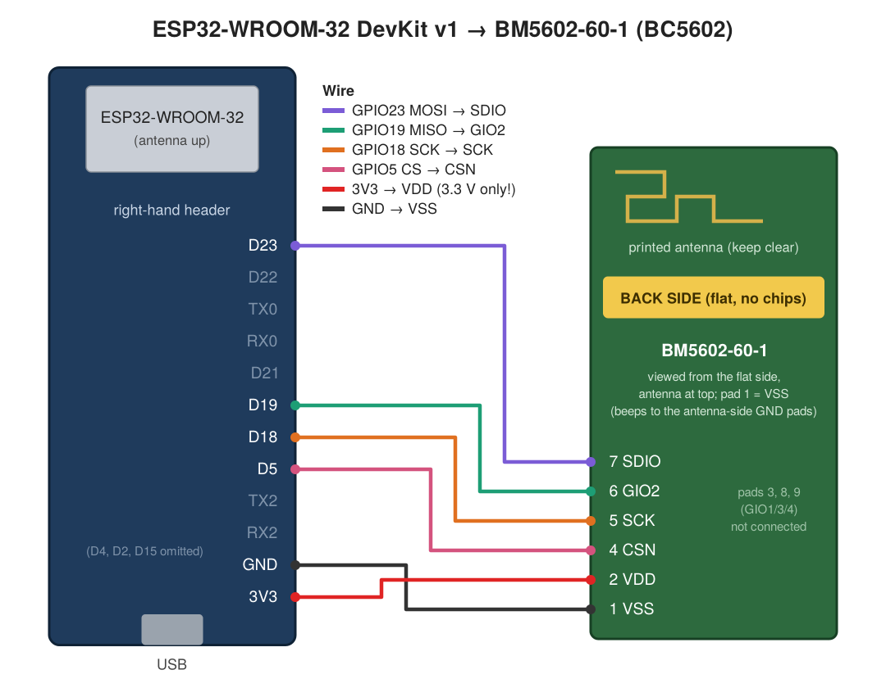

# esphome-benq-halo

ESPHome external component that turns an **ESP32 + Holtek BM5602-60-1** radio
module into a Home Assistant controller for the **BenQ ScreenBar Halo
(1st generation)** monitor light.

The ESP speaks the lamp's own 2.4 GHz protocol: the BM5602 carries the same
Holtek BC5602 transceiver that's inside the lamp and its remote, so framing,
CRC and acknowledgements are all done in hardware.

> Status: working on real hardware (ESP32-WROOM-32 DevKit v1, ESPHome 2026.9.1,
> Home Assistant). On/off, brightness, colour temperature, lamp selection and
> the "A" auto button are all confirmed with the lamp acknowledging every frame.

## What you get in Home Assistant

| Entity | What it does |
|---|---|
| **Light** | on/off, brightness, colour temperature (153–370 mired, ~6500–2700 K) |
| **Select "Lamps"** | Front / Back / Both |
| **Button "Auto mode"** | the remote's "A" button (auto-dimming / sensor mode) |
| **Button "Resync"** | resend the whole state |
| **Button "Pair lamp"** | pair the lamp to the ESP (see below — this is the important one) |
| **Button "Sniff remote pairing"** | log your remote's pairing beacon (diagnostics) |
| **Button "Scan link addresses"** | try to guess your remote's link address (diagnostics) |
| **Binary sensor "Lamp link"** | ON when the lamp acknowledges, OFF if a command was given up |
| **Binary sensor "PC online"** | optional: your PC answers ping |
| **Text sensor "Last radio frame"** | last valid frame heard |

Optional extra: **the lamp can follow your PC** — on when the PC comes online,
off a few minutes after it goes offline (sleep or shutdown), done by the ESP
itself, so it works even when Home Assistant is down.

## Hardware

| Part | Notes | Price |
|---|---|---|
| ESP32-WROOM-32 DevKit v1 (30-pin) | any classic ESP32 works; pins below are for this board | ~€5 |
| Holtek **BM5602-60-1** module | [Best Modules Corp](https://www.bestmodulescorp.com/en/bm5602-60-1.html), Sourcengine, Holtek distributors | ~$3–4 |

Buy two modules: they're cheap and it saves wondering whether one is dead.

> A **CC2500** or **nRF24L01+** will NOT do the job: the nRF24 can't go down to
> 125 kbps, and the CC2500 can't do the 32-bit sync word or the hardware
> auto-ACK the lamp needs (details in the upstream project).

## Wiring



| BM5602 pad | ESP32 DevKit v1 | Role |
|---|---|---|
| 1 VSS | GND | ground |
| 2 VDD | 3V3 | **3.3 V only — never 5 V/VIN** |
| 4 CSN | GPIO5 | chip select |
| 5 SCK | GPIO18 | SPI clock |
| 6 GIO2 | GPIO19 | MISO (firmware switches the chip to 4-wire SPI) |
| 7 SDIO | GPIO23 | MOSI |
| 3 GIO1, 8 GIO3, 9 GIO4 | — | not connected |

**Finding pad 1.** The module has no markings, and the pads are through-holes
visible from both sides, so the order flips depending on which side you look at.
The drawing shows the module from its **back (flat side, no chips), antenna at
the top** — that's how it was wired and verified here. Always confirm with a
meter: pad 1 (VSS) is the only pad that beeps to the two isolated ground pads
next to the antenna.

Keep wires short (≤10 cm is fine at 1 MHz), keep the module's printed antenna
away from metal and from the ESP32's antenna.

## Install

1. Copy `components/` next to your device YAML (in the HA ESPHome add-on that's
   `/config/esphome/components/benq_halo/`), or reference this repo directly:
   ```yaml
   external_components:
     - source: github://Gucioo/esphome-benq-halo
       components: [benq_halo]
   ```
2. Start from [`screenbar-halo.yaml`](screenbar-halo.yaml). Keep
   `default_transition_length: 0s` (the component default) — the lamp fades by
   itself, ESPHome transitions would only spam the radio.
3. Flash once over USB, then OTA. Works from the HA ESPHome add-on, or on
   Windows with `pip install esphome` and `esphome dashboard <folder>`.

First boot log should show:
```
Module: detected (chip version 0x01000F)
Crystal ready: YES, VCO calibration: ...
```
`0xFFFFFF` = MISO not on GIO2. `0x000000` = no power, CSN missing, or SCK/MOSI swapped.

## Pairing the lamp to the ESP (do this once)

Every remote/lamp pair talks on its own 4-byte **link address**, derived from
the remote's ID by an unknown function. The ESP can't learn yours, so instead
it **pairs the lamp to itself**, using a known beacon whose link address is
`4FF0FD63` (the component default):

1. Unplug the lamp's USB.
2. Press **Pair lamp** in Home Assistant (the beacon runs for 60 s).
3. Cover the lamp's light sensor (finger or tape).
4. Plug the lamp back in within ~10 s, keep the sensor covered.
5. Log: `Lamp is acknowledging the pairing beacon!` → `Pairing done: 15 acknowledged…`
6. Uncover the sensor, control the light from HA.

The pairing is stored **in the lamp**: it survives ESP reboots, reflashes and
lamp power cuts. Nothing about it is stored on the ESP — just keep
`address: "4FF0FD63"`.

> **Your original remote stops working.** The lamp remembers only one pairing.
> To go back to the remote, re-pair it the normal BenQ way (lamp unplugged,
> hold favourite + lamp switch ~5 s, cover sensor, plug lamp in). You can switch
> between the two any time.

## Lamp follows your PC (optional)

```yaml
benq_halo:
  pc_presence:
    host: DESKTOP-ABC1234   # PC name (mDNS), DNS name or IP
    off_delay: 2min         # PC silent this long -> lamp off
    # interval: 10s
    # port: 0               # 0 = ping; 445 / 3389 = TCP check if ping is blocked
    # control_lamp: true    # false = only report "PC online"

binary_sensor:
  - platform: benq_halo
    pc_online:
      name: PC online
```

- A background task resolves the name (mDNS, then router DNS), pings every 10 s,
  and reports offline after two misses in a row.
- Lamp turns **on** when the PC comes online, **off** after `off_delay` offline.
- Only *changes* act: if you switch the lamp off while the PC is on, it stays
  off. Nothing happens at ESP boot.
- Windows blocks ping by default. On the PC (admin PowerShell, network = Private):
  ```powershell
  Enable-NetFirewallRule -DisplayName "File and Printer Sharing (Echo Request - ICMPv4-In)"
  ```
  or use `port: 445`.

## All options

```yaml
benq_halo:
  cs_pin: GPIO5
  address: "4FF0FD63"        # link address, register order (= on-air bytes reversed)
  listen: true               # listen to the remote on that address between commands
  brightness_gamma: 2.0      # lamp brightness is ~logarithmic; HA 50 % -> raw 0x78
  repeats: 3                 # frames per command (the remote sends 3)
  min_acks: 2                # ACKs needed to count a command as delivered
  remote_beacon: "XXXXXXXX"  # your remote's ID, for "Scan link addresses"
  pairing_payloads: ["5A5A", "F5C3", "CF49"]  # beacon used by "Pair lamp"
  pc_presence: ...           # see above
```

## What worked and what didn't

The journey, so the next person doesn't repeat it.

| Attempt | Result |
|---|---|
| BM5602 on ESP32-WROOM-32 over hardware SPI, 1 MHz | ✅ chip version `0x01000F`, same as upstream |
| VCO auto-calibration (`ACAL`) | ⚠️ the bit never clears (`OM=0x08`), but RX and TX work anyway — harmless |
| Listening on the upstream default address `4FF0FD63` with my own remote | ❌ silence — every remote has its own address |
| **Sniffing the pairing beacon** (fixed address `59 01 00 B0`) | ✅ ~120 clean frames. My remote: `5A5A · 3525 · 38DD`; upstream's: `5A5A · F5C3 · CF49`. `5A5A` is common, the other 4 bytes are the remote's ID |
| Guessing my link address from the beacon (108 byte-wise relations: XOR / add / bit-reverse × byte orders, fitted to upstream's pair) | ❌ no match — the derivation is not a simple byte relation (likely a hash) |
| Using the BM5602 to sniff unknown addresses | ❌ not possible: its packet engine only passes frames that match the configured address; no raw mode usable (upstream tried direct mode and preamble locking) |
| **Re-pairing the lamp by replaying a beacon from the ESP** | ✅ **works** — lamp acknowledged from the first beacon after power-up. First confirmation of this idea, which upstream had listed as untested |
| On/off, brightness `4C..FE`, colour temp `00..64`, front/back/both, button A | ✅ all delivered with 3/3 ACKs |
| Physical remote after ESP pairing | ❌ stops working: the lamp keeps a single pairing |
| PC presence via mDNS + ICMP from the ESP | ✅ resolves `DESKTOP-…` and follows the PC |

**Still open**
- Keeping the original remote *and* the ESP: needs your remote's real link
  address. A CC2500 in raw serial mode can capture it (upstream found theirs
  that way); then set `address:` to it, re-pair the remote normally, and the ESP
  both transmits as the remote and hears every dial turn.
- How the link address is derived from the beacon ID. If you capture your own
  beacon *and* link address, please open an issue — more pairs might crack it.

## Protocol in one paragraph

GFSK 125 kbps, channel 5 (2405 MHz). Frame: 1-byte preamble, 4-byte address,
9-bit PCF (length 6, PID 2, NO_ACK 1), payload, CRC-16/CCITT (init FFFF, over
address + PCF + payload). Commands are 2 bytes, absolute state, sent 3× ~100 ms
apart and auto-acknowledged by the lamp with an empty ACK (so the lamp's state
can't be read back). Byte 1 flags: `b7 on · b6 front · b5 A · b2 brightness ·
b1 temperature · b0 back`; byte 2 is the value. Full details in the upstream
[PROTOCOL.md](https://github.com/Djoko-cli/benq-screenbar-halo-matter/blob/main/docs/PROTOCOL.md).

## Tests

- `tests/test_protocol.cpp` — on-air encoding and CRC checked bit-for-bit
  against upstream's golden vectors.
- `tests/sim/` — the real component code run against a simulated BC5602 and
  lamp (bursts, slider sweeps, remote tracking, retries, give-up, pairing,
  address scan, reboot restore).

## Credits

This component is an ESPHome re-implementation; the hard part —
reverse-engineering the radio — was done by others:

- **[kuzmin-no](https://github.com/kuzmin-no/BenQ_ScreenBar_HALO_2_HA_integration)** —
  *BenQ ScreenBar HALO 2 → Home Assistant*. The base of all of this: first to
  reverse-engineer the ScreenBar Halo radio and to drive it with a BM5602
  (MicroPython, Raspberry Pi Pico W, MQTT). The BM5602 pinout comes from there.
- **[Djoko-cli](https://github.com/Djoko-cli/benq-screenbar-halo-matter)** —
  *BenQ ScreenBar Halo → Matter*. Ported kuzmin-no's work to ESP32 and worked
  out the different Halo 1 protocol (frame format, payload semantics, pairing
  beacon), the working BC5602 register sequences and timings, and the idea of
  re-pairing the lamp from the ESP. The protocol layer, register values and
  test vectors here come from that work.
- **hertzg** (identifying the BC5602 inside the Halo) and **b4shful** (PCB
  teardown) on the
  [Home Assistant community thread](https://community.home-assistant.io/t/benq-screenbar-support/490864).

ESPHome port, ESP32-WROOM-32 wiring, beacon-replay pairing confirmation and PC
presence: Tom ([Gucioo](https://github.com/Gucioo)), with help from Claude.

## Licence

MIT for the ESPHome integration written here (see [LICENSE](LICENSE)).
The protocol layer (`halo1_protocol.*`), the BC5602 register sequences and the
test vectors follow Djoko-cli's implementation closely. That repository has no
licence file, so those parts are shared with credit and in good faith; if the
author wants different terms, they will be adjusted.
